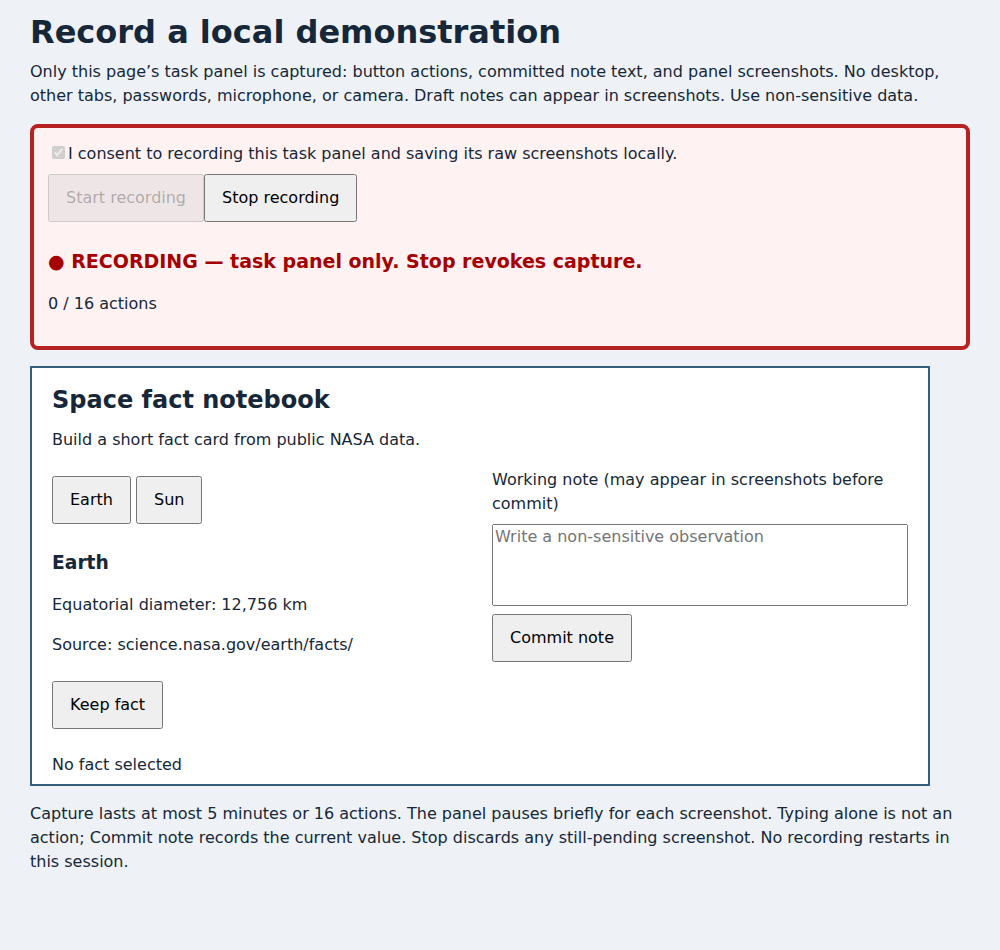
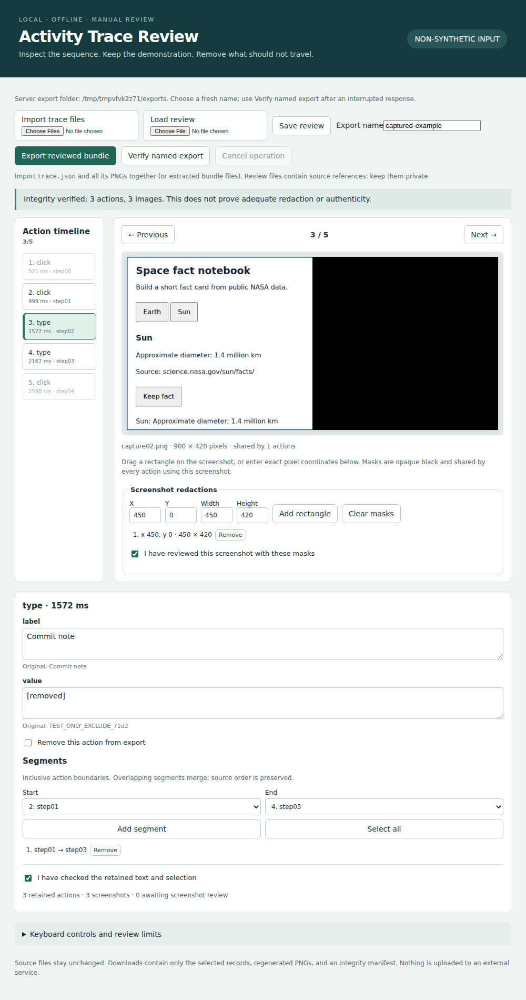

# Activity Trace Review

Record opt-in demonstrations in a bounded local Chromium task page, review the captured actions and screenshots, then export selected, explicitly redacted training examples. The review workbench treats recorded actions as inert data.

## Record → review → export

After the one-time installation below, launch with one command on a Linux desktop:

```sh
.venv/bin/activity-trace record .capture --export-root reviewed-exports
```

1. The browser opens **OFF**. Check the consent box and click **Start recording**. A red **RECORDING** panel stays visible above the task surface.
2. Choose Earth or Sun, keep a fact, and optionally type a non-sensitive note and click **Commit note**. Facts come from public NASA pages; no network access to those pages occurs during capture.
3. Click **Stop recording**. The session saves raw input to the fresh `.capture` directory and displays **Review this recording**. Capture cannot restart in this session. Closing the page before stopping discards the unsaved recording.
4. Open the review link. Select inclusive segments, replace sensitive text, and mask sensitive screenshot regions. Review each retained screenshot and confirm the retained text before exporting.
5. Choose a fresh export name, click **Export reviewed bundle**, then **Verify named export**. Inspect the resulting bundle before sharing it. Close all recorder browser windows or press Ctrl+C to end the local server.

Only the bundled task panel is supported: four task buttons (Earth, Sun, Keep fact, Commit note), committed note values, and post-action panel screenshots. A session stops after **16 actions or 5 minutes**. Typing is captured as text only when committed, but uncommitted notes may appear in screenshots from other actions. The panel pauses while a screenshot is taken. Stop discards any in-flight action/screenshot. No desktop, arbitrary websites, other tabs, navigation, raw keystrokes, pointer paths, audio, or video are recorded. See [capture details and privacy limits](docs/capture.md).



[Inspectable captured source](results/capture/source/trace.json) → [review specification](results/capture/review.json) → [redacted bundle](results/capture/bundle/trace.json). These artifacts were generated by **automated browser interactions** with the actual recorder, using public facts and clearly labeled test-only markers; they are not hand-authored traces or a human usability study. [Verification evidence](results/capture/verification.json) includes before/after-stop exclusion and a pixel-by-pixel export check. The non-synthetic flag means the events/screenshots were captured from a running browser; it does not attest to a human operator or useful training quality.



## Install and try it

Requires Python 3.11+ on Linux with libc `renameat2`, filesystem `RENAME_NOREPLACE` support, and file/directory fsync (tested on Linux/Python 3.12). Other platforms fail closed for export. Package installation needs an available Pillow wheel; the application itself runs offline. Chromium is needed for recording and browser verification. Recording opens a visible browser and requires a graphical Linux session; the headless verification runs without a display. Review/export alone require only the base package.

```sh
python3 -m venv .venv
.venv/bin/python -m pip install -e ".[capture]"
PLAYWRIGHT_BROWSERS_PATH=/tmp/activity-trace-browsers .venv/bin/python -m playwright install chromium
.venv/bin/activity-trace record .capture
```

If `venv` reports that `ensurepip` is missing, install your operating system's Python venv support before creating the environment. Open the complete `http://127.0.0.1:8765/#…` URL printed by the server. Its random token is required; keep it private. The server binds only to loopback. Ctrl+C stops it.

1. Inspect actions with the timeline, Previous/Next, or arrow keys. Each action displays its timestamp, text, and synchronized screenshot.
2. Choose inclusive start/end actions and add segments. Remove the initial full-trace segment when selecting a subset. Overlapping segments merge in source order.
3. Remove unwanted actions. Replace individual text fields, including URLs. An empty replacement keeps the field with an empty string.
4. Drag opaque black rectangles over screenshots, or enter exact integer pixel coordinates. A mask applies to every retained action sharing that screenshot. Changing a mask clears that screenshot's review state.
5. Explicitly review every retained screenshot and confirm the retained text and selection. Export remains disabled until those checks are complete.
6. Save the source-bound review JSON to resume later. Choose a fresh export name. Export publishes a complete verified directory in the displayed server export folder, then requests a deterministic ZIP download containing `trace.json`, `manifest.json`, and regenerated PNGs. **Verify named export** checks that directory independently. Import its files to reopen it. The app never extracts arbitrary ZIP inputs.

`serve --export-root /path/to/private/exports` chooses the server export folder; the default is `reviewed-exports` in the working directory. `serve` without a source opens an empty workbench. Use **Import trace files** to select `trace.json` and all referenced PNGs together. Extracted exported bundles can include their manifest. Invalid imports and review loads leave the current work unchanged. A valid source import replaces the current review; save it first. Reviews are not autosaved to disk. Refreshing requires reopening the complete server URL and can discard unsaved browser edits.

Keyboard controls (outside editable controls): ← / →, Home / End, `[` / `]` to set segment boundaries, `A` to add a segment, `D` to toggle removal, and `R` to toggle screenshot review. Ctrl/Cmd+S saves a review, including while editing a field.

## CLI example

For the older synthetic review-only fixture, run `activity-trace demo .demo`. The `demo` command also creates `example-review.json`. That specification marks the **known planted synthetic fixture** as reviewed; it is an executable example, not an automatic privacy reviewer. Newly created reviews and all browser imports start unconfirmed.

```sh
.venv/bin/activity-trace inspect .demo/source
.venv/bin/activity-trace review .demo/source .demo/my-review.json
.venv/bin/activity-trace export .demo/source .demo/example-review.json .demo/export
.venv/bin/activity-trace verify .demo/export
.venv/bin/activity-trace serve .demo/export
```

The destination parent must already exist. All output destinations must be fresh. A collision, including an existing empty directory, is rejected. Source files are read without alteration. `inspect` reports SHA-256 hashes of the exact input trace and referenced image bytes. Keep source files and review specifications private. Only share an export after checking it. `verify` (`validate` is an alias) establishes internal integrity, not authenticity or adequate redaction.

## Verification

Focused recording-to-export verification (after caching Chromium):

```sh
.venv/bin/python tests/capture_flow.py
.venv/bin/activity-trace verify results/capture/bundle
```

This regenerates the public/test-only capture demonstration, drives visible consent controls in headless Chromium, checks trusted button events, ignores untrusted DOM dispatches, tests stop during an in-flight screenshot, the 16-action limit, and both timer guards, and independently checks all 1,134,000 exported pixels. It does not require a human to consent on behalf of another person.


Install verification tools and cache the browser and runtime wheel once (these preparation steps use the network):

```sh
.venv/bin/python -m pip install -r requirements-dev.txt
PLAYWRIGHT_BROWSERS_PATH=/tmp/activity-trace-browsers .venv/bin/python -m playwright install chromium
.venv/bin/python -m pip download --only-binary=:all: --no-deps --dest /tmp/activity-trace-wheelhouse Pillow==11.3.0
```

Then run the complete verification offline with one command:

```sh
.venv/bin/python scripts/verify.py
```

The command requires GNU `/usr/bin/time` for measured peak RSS. It runs the core tests, **240 seeded independent export cases**, the synthetic review and real capture Chromium workflows with non-workbench browser requests blocked, an isolated wheel-installed CLI example with Python network connection/DNS APIs denied, and two bounded performance workloads. It checks deterministic replay, source hashes, SIGKILL at eight publication stages, competing writers, partial writes, fsync failures, staging rejection, and browser/installed-CLI recovery. It updates [measured results](results/verification.json), [browser evidence](results/browser.json), [benchmarks](results/benchmark.json), and [plain test output](results/tests.log). `TRACE_WHEELHOUSE` and `PLAYWRIGHT_BROWSERS_PATH` override the caches. Offline verification cannot bootstrap absent dependencies.

See [transaction guarantees and recovery](docs/transactions.md), [format and review semantics](docs/format.md), [validation scope and limitations](docs/validation.md), and [related work](docs/related-work.md).

## Limits that matter

Manual review **cannot guarantee de-identification**. Retained text, timestamps, action kinds, and unmasked pixels may identify someone or disclose sensitive information. Export intentionally preserves retained timestamps; it does not anonymize timing. Original identifiers, source filenames, input hashes, image metadata, unreferenced screenshots, removed actions, review files, and replaced text are excluded from the generated artifact structure. This is not a promise that another retained field or unmasked image cannot contain the same information.

Input is bounded to 128 actions, 64 PNGs, 24 MiB, 2,048 pixels per image side, and 16,777,216 total decoded pixels. JSON is limited to 512 KiB. Each CLI operation or API request has a 10-second POSIX timer; core loops also check cancellation and time. Detailed bounds are in the format document. Extremely slow machines or incompressible images can hit a limit before reaching the maximum action count.

The server is a single-user local tool, not a hardened shared service. Anyone controlling the local machine or possessing the token can access the loaded trace. Review files and downloads are ordinary files with no encryption. Browser export cancellation prevents the download request in the UI; already submitted server work may publish. Verify the named destination before retrying. Imports cannot be cancelled once submitted for their atomic validation/commit. An interrupted export leaves the destination absent or complete on the supported filesystem; incomplete `.trace-stage-*` siblings may remain. Preserve the review, verify the destination, and retry into a fresh name if needed. Inspect and manually remove only owned inactive staging. No power-loss guarantee is claimed.

The bundled recorder is tested with Chromium; compatibility with other activity recorders is not established. Human usability, screen-reader usability, other browsers, macOS, Windows, adversarial native image decoders, and downstream model training have not been validated. No novelty claim, automatic secret detection, medical claim, or training-quality claim is made.
